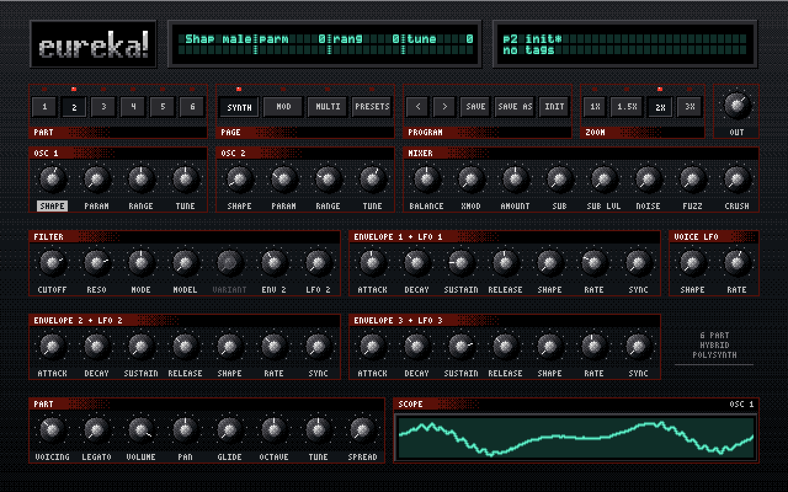

# eureka!

**A six-part hybrid polysynth plug-in by Tootable Instruments, built on the
Mutable Instruments Ambika.**



*This branch (`pixel-gui`) adds an optional pixel faceplate interface: a 640x400
bitmap panel in a strict 16-colour palette, zoomable 1x / 1.5x / 2x / 3x. More
pages: [mod matrix](docs/images/screenshot-pixel-mod-1-8.png),
[multi](docs/images/screenshot-pixel-multi.png),
[presets](docs/images/screenshot-pixel-presets.png).*

eureka! runs the original Ambika voicecard firmware natively on your
computer. It adds a model of the analog filter and VCA, a choice of Surge XT
filters, stereo panning and a modern interface. It comes as VST3, AU and a
standalone app for macOS.

- 6 parts, each with its own patch, and 6 voices you can share between them
- The Ambika's oscillators and wavetables, plus 3 envelopes, 4 LFOs and a
  14-slot modulation matrix
- Ambika SVF filter model plus 8 Surge XT filters
- Keyboard splits, cyclic and poly voice allocation, and unison up to 6 voices
- Preset browser with tags, the 128 Ambika factory programs built in, and
  import of Ambika `.PAT` / `.PRO` / `.MUL` / `.syx` files
- Light and dark themes with your own highlight colour, plus image skins

---

## Installing

1. Download `eureka-macOS.zip` from
   [Releases](https://github.com/Milkman8008/ambika-vst/releases) and unzip it.
2. Copy `eureka!.vst3` to `/Library/Audio/Plug-Ins/VST3/` (or the
   `eureka!.component` to `/Library/Audio/Plug-Ins/Components/` for AU).
3. Downloaded builds are not notarized. If macOS blocks the plug-in, run this
   once in Terminal:
   ```sh
   xattr -dr com.apple.quarantine "/Library/Audio/Plug-Ins/VST3/eureka!.vst3"
   ```
4. Rescan your plug-ins. In Ableton Live, hold **Option** and click
   **Rescan** in Preferences → Plug-Ins. eureka! appears under
   **Tootable Instruments**.

To build it yourself, see [Building](#building).

---

## Quick start

1. Load eureka! on a MIDI track and play: you hear part 1's **Init** sound,
   with all six voices playing it polyphonically.
2. Click **Browse** and double-click a factory program to load it.
3. Shape the sound on the **Synth** page, then save it with **Save as...**.

## The interface

**Header (top row)**
- **Synth / Mod / Multi**: the three pages.
- **Edit part 1-6**: chooses which part the Synth and Mod pages edit. Each
  part has its own colour.
- **Voices**: one light per voice, in the colour of the part that is playing
  on it.
- **Out**: master output level.
- **Colour swatch**: type a hex code (for example `#E0457B`) to change the
  highlight colour for the edited part, or tick **All parts** to change every
  part. **Reset** restores the theme colours.
- **Sun / moon**: switches between light and dark mode.

**Preset bar (under the header)**: shows the edited part's preset. A `*`
means it has changed since it was loaded or saved.

### Synth page: the sound of the edited part

- **Oscillator 1 & 2**: waveform (classic shapes, wavetables, formant,
  noise...), parameter, range and tune.
- **Mixer**: oscillator balance, cross-modulation (sum, sync, ring mod, xor,
  fold, bits), sub-oscillator, noise, fuzz and bit crush.
- **Filter**: choose the **Model**:
  - **Ambika SVF**: low-pass, band-pass or high-pass.
  - **Surge filters**, chosen with **Model**:
    - MULTI Xpander
    - LP Diode Ladder
    - LP Legacy Ladder
    - LP Vintage Ladder
    - FX Comb+
    - FX Comb-
    - FX Sample and Hold
    - FX Cutoff Warp AP

    **Variant** picks the filter's flavour.

  Frequency, resonance, the envelope 2 amount and the LFO 2 amount work with
  every model. The display shows the response curve.
- **Voice**: voicing (poly, mono, 2x unison, cyclic), legato, volume, pan,
  glide, octave, tune and unison spread.
- **Envelope 1-3 / LFO 1-3**: three ADSR envelopes and three LFOs; the LFOs
  can sync to the host tempo. Envelope 2 shapes the filter (Env 2 amount)
  and, through the modulation matrix, the volume. Envelopes 1 and 3 are free
  for the matrix.
- **Voice LFO**: LFO 4, which runs separately on each voice.

### Mod page

- **Modulation matrix**: 14 slots, each with a source, a destination and an
  amount. Any source can drive almost anything, including **pan** for
  auto-pan or a random stereo spread. Slot 14 is scaled by the mod wheel.
- **Modifiers**: combine two sources into new sources, mod. 1 to mod. 4.
  The operators are add, multiply, attenuate, max, min, xor, quantize and
  lag.

### Multi page: playing several parts at once

- **Voices 1-6**: each voice chooses which part it plays, or **off**.
  **Edit part** jumps to that part's sound.
- **Voice allocation**: decides how notes reach the voices:
  - **Poly** (default): each note takes the free voice that has rested
    longest.
  - **Cyclic**: notes step through voices 1 → 6 in order. Give the voices
    different parts and every note plays the next patch.
  - **Per part**: works like the original hardware. Each part plays every
    note on its own voices, using its own Voicing setting, and parts layer.
  - **Unison** (Poly and Cyclic): plays 1-6 voices per note, detuned by each
    part's Spread.
- **Keyboard splits**: a lowest and highest key for each part. Use them to
  put a bass on the left hand and a lead on the right, or set overlapping
  ranges for layers.

eureka! listens on every MIDI channel. The sustain pedal works in all modes.

**Example layouts**
- *Big poly*: all six voices on part 1, voice mode Poly.
- *Round robin*: voices 1-3 on part 1 and voices 4-6 on part 2, voice mode
  Cyclic. Notes alternate between the two sounds.
- *Split*: voices 1-2 on part 1 with keys up to B2, voices 3-6 on part 2
  from C3 up.
- *Thick lead*: voice mode Poly with Unison 3, which gives two notes of three
  voices each.

## Presets

A preset stores the sound of one part. The voice setup on the Multi page is
saved with your DAW project instead.

- **< / >**: previous or next preset.
- **Save**: overwrites the current preset.
- **Save as...**: saves a new preset with a name, tags, author and comment.
- **Init**: resets the edited part, or **Everything** (all six parts plus
  the voice setup).
- **Browse**: search, filter by tag, double-click to load, rename, delete,
  or show the presets folder.

Your presets are saved in **Documents/eureka/presets** as `.eurekapreset`
files. You can copy them to share them, and sub-folders are included.

**Ambika sounds**: the 128 Ambika factory programs are built in. In the
browser they are tagged **Factory** and are read only: load one and use
**Save as...** to keep your own version. **Import Ambika files...** opens
original Ambika SD-card files (`.PAT`, `.PRO`, `.MUL`) and SysEx dumps
(`.syx`). It can load a file straight into the edited part (a `.MUL` multi
sets up all six parts), or add whole folders to your library under
`presets/Imported`.

## Custom looks (skins)

You can change the background, logo and knobs with images you edit in
Photoshop or any image editor. A template pack with guide images is in
[`plugin/skin-template`](plugin/skin-template) (see its README.txt). Put
your files in **Documents/eureka/skin** and reopen the plug-in window.

## Not included (yet)

- The Ambika's arpeggiator and step sequencer, ragas and microtuning
- Separate outputs for each part; eureka! has one stereo output
- Windows builds

---

## Building

You need macOS with the Xcode command line tools and CMake 3.22 or newer.

```sh
git clone --recursive https://github.com/Milkman8008/ambika-vst.git
cd ambika-vst
cmake -S plugin -B plugin/build/release -DCMAKE_BUILD_TYPE=Release
cmake --build plugin/build/release -j8
```

The built plug-ins end up in
`plugin/build/release/AmbikaPlugin_artefacts/Release/`, under `VST3/`, `AU/`
and `Standalone/`. Developer notes (how the firmware is ported, the filters,
tests and preset format) are in [plugin/README.md](plugin/README.md).


## Building (Windows)

Requires Visual Studio 2022 or newer (Desktop C++ workload) and CMake 3.22+.

```sh
git clone --recursive https://github.com/Milkman8008/eureka-vst.git
cd eureka-vst
cmake -S plugin -B plugin/build/win -G "Visual Studio 18 2026" -A x64
cmake --build plugin/build/win --config Release --target AmbikaPlugin_VST3 AmbikaPlugin_Standalone -- -m:1
```

(Use `-G "Visual Studio 17 2022"` with VS 2022.) Clone to a short path such
as `C:\src` to stay under the Windows path-length limit. The VST3 ends up in
`plugin/build/win/AmbikaPlugin_artefacts/Release/VST3/`; copy `eureka!.vst3`
to `C:\Program Files\Common Files\VST3\`.

## Credits and licence

eureka! is built on the **Ambika** by **Mutable Instruments**: the firmware
and design are by Emilie Gillet. The original Ambika README is in
[AMBIKA-README.md](AMBIKA-README.md), and the hardware and firmware sources
are kept in this repository unchanged. The extra filters come from
**Surge XT** (sst-filters, by the Surge Synth Team). The plug-in is built
with **JUCE**.

eureka! is released under the **GPL-3.0**, like the Ambika firmware and the
Surge filters.
