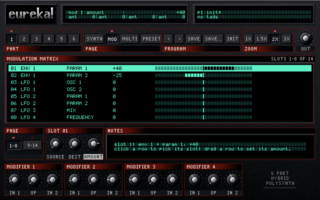
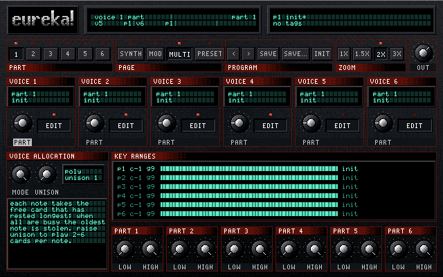
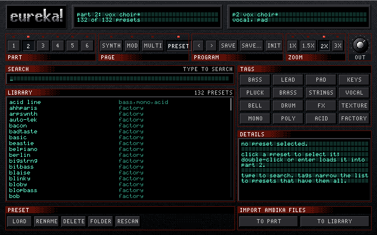

<p align="center">
  
</p>

<h1 align="center">eureka!</h1>

<p align="center"><b>A six-part hybrid polysynth plug-in by Tootable Instruments, built on the
Mutable Instruments Ambika.</b></p>

<p align="center">
  
</p>

eureka! runs the original Ambika voicecard firmware natively on your
computer. It adds a model of the analog filter and VCA, a choice of Surge XT
filters and stereo panning.

This is the Windows edition, a fork of
[Milkman8008/eureka-vst](https://github.com/Milkman8008/eureka-vst). It adds
Windows builds and a new interface: a hand-pixelled, mid-90s hardware
faceplate. The panel is a 640x400 bitmap in a strict 16-colour palette, with
bitmap fonts, a 40x2 VFD-style display and a live oscilloscope. You can zoom
it to 1x, 1.5x, 2x or 3x. It comes as VST3 and as a standalone app.

- 6 parts, each with its own patch, and 6 voices you can share between them
- The Ambika's oscillators and wavetables, plus 3 envelopes, 4 LFOs and a
  14-slot modulation matrix
- Ambika SVF filter model plus 8 Surge XT filters
- Keyboard splits, cyclic and poly voice allocation, and unison up to 6 voices
- Preset library with search and tags, the 128 Ambika factory programs built
  in, and import of Ambika `.PAT` / `.PRO` / `.MUL` / `.syx` files
- Pixel faceplate at 1x / 1.5x / 2x / 3x; the last size you pick is
  remembered for every song and new instance

<p align="center">
  
  
  <br>
  
  <br><i>The Mod, Multi and Preset pages.</i>
</p>

## Demo

<p align="center">
  <a href="https://youtu.be/OeMAyKnqreM">
    
  </a>
  <br>▶ <a href="https://youtu.be/OeMAyKnqreM"><b>Watch a short demo of eureka! on YouTube</b></a>
  <br><i>The demo shows the original interface; the sound engine is the same.</i>
</p>

---

## Installing (Windows)

1. Download `eureka-pixel-windows-x64.zip` from
   [Releases](https://github.com/Phaos2000/eureka-vst/releases/latest) and
   unzip it.
2. Copy the `eureka!.vst3` folder to `C:\Program Files\Common Files\VST3\`.
3. Rescan plug-ins in your DAW. eureka! appears under
   **Tootable Instruments**. Or run `eureka!.exe` for the standalone app.

The builds are not code-signed, so Windows SmartScreen may warn the first
time. The same release also has `eureka-classic-windows-x64.zip` with the
original eureka! interface. Both are the same plug-in with the same sounds
and saved songs, so installing one replaces the other.

For macOS, the original release is at
[Milkman8008/eureka-vst](https://github.com/Milkman8008/eureka-vst/releases).
This version can be built on a Mac (see [Building](#building)), but it has
only been tested on Windows.

---

## Quick start

1. Load eureka! on a MIDI track and play: you hear part 1's **Init** sound,
   with all six voices playing it polyphonically.
2. Click **PRESET**, then double-click a factory program to load it.
3. Shape the sound on the **SYNTH** page, then save it with **SAVE...**.

## The interface

**Top row** (the same on every page)
- **PART 1-6**: chooses which part the Synth and Mod pages edit.
- **PAGE**: **SYNTH**, **MOD**, **MULTI** and **PRESET**.
- **PROGRAM**: **< / >** steps through presets. **SAVE** overwrites the
  current preset and **SAVE...** saves a new one. **INIT** resets the edited
  part, or all parts.
- **ZOOM**: 1X, 1.5X, 2X or 3X.
- **OUT**: master output level.

**Displays**: the left display shows the control you are touching and its
value. The right display shows the edited part's preset and its tags; a `*`
means it has changed since it was loaded or saved.

Drag a knob up and down to change it.

### Synth page: the sound of the edited part

- **OSC 1 & OSC 2**: waveform (classic shapes, wavetables, formant,
  noise...), parameter, range and tune.
- **MIXER**: oscillator balance, cross-modulation (sum, sync, ring mod, xor,
  fold, bits), sub-oscillator, noise, fuzz and bit crush.
- **FILTER**: choose the **MODEL**:
  - **Ambika SVF**: low-pass, band-pass or high-pass.
  - **Surge filters**:
    - MULTI Xpander
    - LP Diode Ladder
    - LP Legacy Ladder
    - LP Vintage Ladder
    - FX Comb+
    - FX Comb-
    - FX Sample and Hold
    - FX Cutoff Warp AP

    **VAR** (variant) picks the filter's flavour.

  Cutoff, resonance, the envelope 2 amount and the LFO 2 amount work with
  every model. When you touch a filter control, the scope shows the
  response curve.
- **ENVELOPE 1-3 + LFO 1-3**: three ADSR envelopes and three LFOs; the LFOs
  can sync to the host tempo. Envelope 2 shapes the filter (ENV 2 amount)
  and, through the modulation matrix, the volume. Envelopes 1 and 3 are free
  for the matrix.
- **VOICE LFO**: LFO 4, which runs separately on each voice.
- **PART**: voicing (poly, mono, 2x unison, cyclic), legato, volume, pan,
  glide, octave, tune and unison spread.
- **SCOPE**: a live view of what you are editing, such as the oscillator
  waveform or the filter response.

### Mod page

- **MODULATION MATRIX**: 14 slots, each with a source, a destination and an
  amount, shown as slots 1-8 and 9-14. Click a row to select its slot, then
  set it with the **SOURCE**, **DEST** and **AMOUNT** knobs, or drag the row
  left and right to set its amount. Any source can drive almost anything,
  including **pan** for auto-pan or a random stereo spread. Slot 14 is
  scaled by the mod wheel, as on the hardware.
- **MODIFIER 1-4**: combine two sources (**IN 1**, **IN 2**) with an
  operator (**OP**) into new sources. The operators are add, multiply,
  attenuate, max, min, xor, quantize and lag.

### Multi page: playing several parts at once

- **VOICE 1-6**: each voice chooses which part it plays, or off. **EDIT**
  jumps to that part's sound.
- **VOICE ALLOCATION**: **MODE** decides how notes reach the voices:
  - **Poly** (default): each note takes the free voice that has rested
    longest.
  - **Cyclic**: notes step through voices 1 → 6 in order. Give the voices
    different parts and every note plays the next patch.
  - **Per part**: works like the original hardware. Each part plays every
    note on its own voices, using its own voicing setting, and parts layer.

  **UNISON** (Poly and Cyclic) plays 1-6 voices per note, detuned by each
  part's spread.
- **KEY RANGES**: a **LOW** and **HIGH** key for each part. Use them to put
  a bass on the left hand and a lead on the right, or set overlapping ranges
  for layers.

eureka! listens on every MIDI channel. The sustain pedal works in all modes.

**Example layouts**
- *Big poly*: all six voices on part 1, mode Poly.
- *Round robin*: voices 1-3 on part 1 and voices 4-6 on part 2, mode
  Cyclic. Notes alternate between the two sounds.
- *Split*: voices 1-2 on part 1 with keys up to B2, voices 3-6 on part 2
  from C3 up.
- *Thick lead*: mode Poly with unison 3, which gives two notes of three
  voices each.

### Preset page

A preset stores the sound of one part. The voice setup on the Multi page is
saved with your DAW project instead.

- **SEARCH**: just type. **TAGS** narrow the list to presets that have all
  the tags you pick.
- **LIBRARY**: click a preset to see its details; double-click it (or press
  Enter) to load it into the edited part.
- **LOAD**, **RENAME**, **DELETE**, **FOLDER** (opens the presets folder)
  and **RESCAN**.
- **IMPORT AMBIKA FILES**: opens original Ambika SD-card files (`.PAT`,
  `.PRO`, `.MUL`) and SysEx dumps (`.syx`). **TO PART** loads a file straight
  into the edited part (a `.MUL` multi sets up all six parts); **TO LIBRARY**
  adds whole folders to your library under `presets/Imported`.
- **SAVE...** (top row) saves a new preset with a name, tags, author and
  comment.

Your presets are saved in **Documents/eureka/presets** as `.eurekapreset`
files. You can copy them to share them, and sub-folders are included.

The 128 Ambika factory programs are built in. They are tagged **Factory**
and are read only: load one and use **SAVE...** to keep your own version.

## Not included (yet)

- The Ambika's arpeggiator and step sequencer, ragas and microtuning
- Separate outputs for each part; eureka! has one stereo output

---

## Building

### Windows

Requires Visual Studio 2022 or newer (Desktop C++ workload) and CMake 3.22+.

```sh
git clone --recursive https://github.com/Phaos2000/eureka-vst.git
cd eureka-vst
cmake -S plugin -B plugin/build/win -G "Visual Studio 18 2026" -A x64
cmake --build plugin/build/win --config Release --target AmbikaPlugin_VST3 AmbikaPlugin_Standalone -- -m:1
```

(Use `-G "Visual Studio 17 2022"` with VS 2022.) Clone to a short path such
as `C:\src` to stay under the Windows path-length limit. The VST3 ends up in
`plugin/build/win/AmbikaPlugin_artefacts/Release/VST3/`; copy `eureka!.vst3`
to `C:\Program Files\Common Files\VST3\`.

### macOS

You need the Xcode command line tools and CMake 3.22 or newer.

```sh
git clone --recursive https://github.com/Phaos2000/eureka-vst.git
cd eureka-vst
cmake -S plugin -B plugin/build/release -DCMAKE_BUILD_TYPE=Release
cmake --build plugin/build/release -j8
```

The built plug-ins end up in
`plugin/build/release/AmbikaPlugin_artefacts/Release/`, under `VST3/`, `AU/`
and `Standalone/`. Developer notes (how the firmware is ported, the filters,
tests and preset format) are in [plugin/README.md](plugin/README.md).

## Credits and licence

eureka! is by **Tootable Instruments**
([Milkman8008/eureka-vst](https://github.com/Milkman8008/eureka-vst)); the
Windows port and the pixel faceplate are by Phaos2000. It is built on the
**Ambika** by **Mutable Instruments**: the firmware and design are by Emilie
Gillet. The original Ambika README is in [AMBIKA-README.md](AMBIKA-README.md),
and the hardware and firmware sources are kept in this repository unchanged.
The extra filters come from **Surge XT** (sst-filters, by the Surge Synth
Team). The plug-in is built with **JUCE**.

eureka! is released under the **GPL-3.0**, like the Ambika firmware and the
Surge filters.
